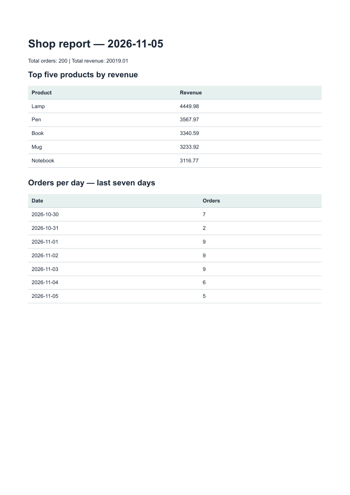

# Shop PDF reports

This API turns a seeded little-shop SQLite dataset into an eight-page PDF, stores it on disk, and returns a download link. This is a reconstruction begun on 2026-11-05, with newly executed stage checkpoints; it preserves the earlier repository and does not claim historical student development. Only the seven required stages are included.

## Run (Python 3.10+)

```powershell
python -m pip install -r requirements.txt
python -m playwright install chromium
python data.py
python -m uvicorn app:app --port 8107 --workers 1
```

Seed uses six products and 200 invented orders (amounts 5–200; dates within the previous 30 days). Running `python data.py` twice leaves 200 rows. Run commands from the repository directory. First Chromium download needs internet; on this machine the complete clean-clone install/seed/generate/download check took under five minutes (see BUILDLOG).

```powershell
curl.exe -i -X POST http://127.0.0.1:8107/reports
curl.exe http://127.0.0.1:8107/reports/REPLACE_ID
curl.exe -o my-report.pdf http://127.0.0.1:8107/reports/REPLACE_ID/file
```

Replace REPLACE_ID with the returned id. First POST: 201 and {"id":"...","file":"/reports/.../file"}. Further same-day POST: 200 and the same id. To force a new report:

```powershell
curl.exe -X POST http://127.0.0.1:8107/reports -H 'Content-Type: application/json' -d '{"force":true}'
```

## Aggregation SQL

`getReportData()` in report_data.py returns two totals, top five products, and daily counts. The date parameters are today minus six days, then today, both ISO dates.

```sql
SELECT COUNT(*) AS total_orders,
       COALESCE(ROUND(SUM(amount),2),0) AS total_revenue FROM orders;
SELECT product, ROUND(SUM(amount),2) AS revenue FROM orders
GROUP BY product ORDER BY revenue DESC, product LIMIT 5;
SELECT created_at AS day, COUNT(*) AS orders FROM orders
WHERE created_at >= ? AND created_at <= ?
GROUP BY created_at ORDER BY created_at;
```

## Fresh proof (2026-11-05)

The Stage 4 POST returned 201 in 0.817 s with id `11817d4a-091e-4650-ab67-60cc4910cc2f`. Download: 200, application/pdf, 58,795 bytes starting `%PDF-`; eight A4 pages. Unknown metadata and file ids both returned 404. These timings are measured, not delayed artificially.

Two concurrent POSTs in Stage 5 returned [201, 200], both id `7c516998-ce88-412b-8628-2c85be852b9a`, with exactly one new PDF. force:true returned 201 with distinct id `04262d08-92c2-4c1d-b426-64625342f274`. IDs shown here are local proof, not permanent hosted links.

I would move rendering out of the request when report size or concurrent traffic makes the wait exceed the response-time target.

The daily check protects against double clicks creating duplicate PDFs. Without idempotency, a report-and-email feature could email the same customer twice and incur duplicate delivery charges. Use the documented single worker: the in-process lock covers simultaneous requests there; multiple processes would need a database-level lock.

The generated database and reports directory are ignored; the seed is their recipe. JSON contains links and metadata, never PDF bytes. Print CSS keeps rows intact and repeats the table header. [All eight pages reviewed](all-pages-review.png).



## Requirement checklist

- [x] Repeatable 200-order seed and report.db.
- [x] One four-section aggregation function and pasted SQL.
- [x] Real multi-page PDF with full detail, intact rows and repeated headers.
- [x] POST 201; metadata/file GET; unknown id 404.
- [x] Store on disk and serve by link.
- [x] Rapid duplicate requests create one file; force creates another.
- [x] Public repository, seven genuine stage commits, startup commands, proof and screenshot.

Run `python -m pytest -q` for the regression checks. Optional extras and the AI rematch are excluded.
